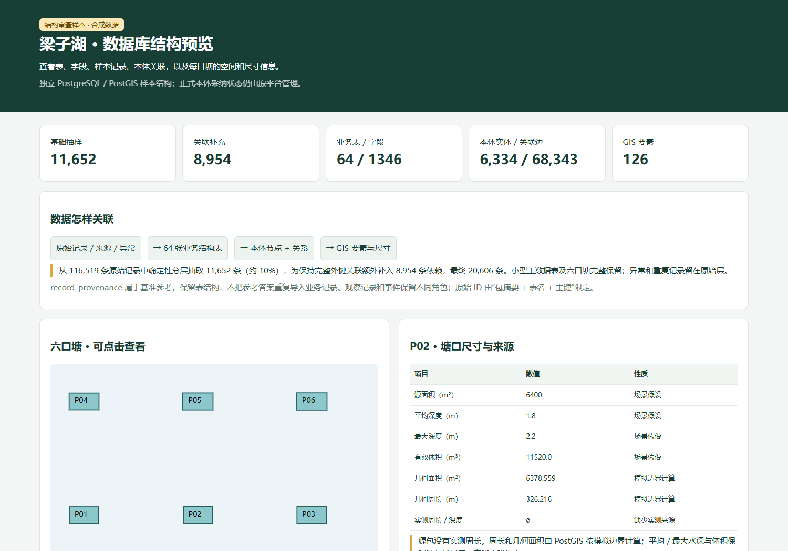

# 梁子湖农业本体数据库

本体数据库的主仓库：**[lianggeming14/liangzihu-ontology-traceability](https://github.com/lianggeming14/liangzihu-ontology-traceability)**。当前维护入口为 [`ontology-platform/`](ontology-platform/README.md)。

## 当前更新：十分之一数据结构审查

| 要看什么 | 入口 |
| --- | --- |
| 样本说明、范围与验收结果 | **[数据结构审查](ontology-platform/docs/fish/review-sample/README.md)** |
| 页面截图 | [预览图片](ontology-platform/docs/fish/review-sample/preview.png) |
| 交互页面 | [index.html](ontology-platform/docs/fish/review-sample/index.html)，下载后用浏览器打开 |
| 全部业务表、字段与外键 | [PostgreSQL / PostGIS 建库 SQL](ontology-platform/docs/fish/review-sample/schema.sql) |
| 逐表样例与实库回读 | [readback.json](ontology-platform/docs/fish/review-sample/readback.json) |
| 本地重建配置 | [fish-review.example.json](ontology-platform/config/fish-review.example.json) |
| 五份实际工程图 | [图纸数据与 GIS 接口](ontology-platform/docs/gis/drawings.md) |

基础抽样 **11,652 / 116,519** 条，约 10%。为补齐外键依赖，额外包含 **8,954** 条，总样本 **20,606** 条。数据库保留 **64 张业务表、1,346 个来源字段**；图模型中包括 **6,334 个实体、13,047 个观测记录、1,167 个事件索引及 68,343 条关联边**。PostGIS 保存 **126 个空间要素**，其中六口塘可分别查看面积、深度、体积及边界计算周长。

这是用户审查中的独立样本库。原始行与规范字段已做 PostgreSQL 实库回读；这些结果不代表原平台全量正式本体采纳完成。**全量导入等待本次结构审查。** ZIP 是模拟养殖场数据，ERA5 天气保留 `imported_unverified`；没有实测来源的周长和水深不能被模拟值替代，也未自动合并到五张工程图的真实对象。



## 本地查看和重建

仅查看已生成的样本页面：

```sh
python -m http.server 8765 --bind 127.0.0.1 --directory ontology-platform/docs/fish/review-sample
```

浏览器打开 `http://127.0.0.1:8765/`，无需数据库登录。GitHub 文件页面显示 HTML 源码；交互查看请使用上述本地入口。

重建样本数据库，先按[样本配置与运行说明](ontology-platform/docs/fish/review-sample/README.md)准备已校验的来源包和私有数据库环境。示例配置不包含密码，预检不写数据库。

```sh
cd ontology-platform
python -m pip install -r scripts/requirements-fish-review.txt
python scripts/build_fish_review_sample.py --config config/fish-review.example.json --plan
python scripts/build_fish_review_sample.py --config config/fish-review.example.json
python scripts/build_fish_review_sample.py --config config/fish-review.example.json --verify
```

## 仓库结构与配置

| 目录 | 内容 |
| --- | --- |
| `ontology-platform/backend` | 当前平台 API、权限、摄取、本体及 worker |
| `ontology-platform/database` | 核心与各领域存储迁移、PostGIS 和 Fuseki 配置 |
| `ontology-platform/frontend` | 当前平台 React 工作台 |
| `ontology-platform/config` | 无凭据的样本配置模板 |
| `ontology-platform/docs/fish/review-sample` | 当前样本结构、少量规范化示例与审查页面 |
| `ontology-platform/scripts` | 建库、预检、验证与运行工具 |
| `implementation` | 旧 v0.4 工程；历史入口，不与当前平台混用 |
| `交付文档`、`设计草案` | 已交付文档与历史设计 |

当前平台完整启动与多库存储配置见 [工程 README](ontology-platform/README.md)、[数据库说明](ontology-platform/database/README.md)及[环境运行手册](ontology-platform/docs/operations/environment.md)。

仓库维持 Public，默认分支 `main`。访问令牌、密码、依赖、活动数据库和原始运行资产由忽略规则排除。清理明细及重新上传方式见 [仓库维护记录](ontology-platform/docs/operations/repository-maintenance.md)和 [GitHub 同步说明](GITHUB_SYNC.txt)。
