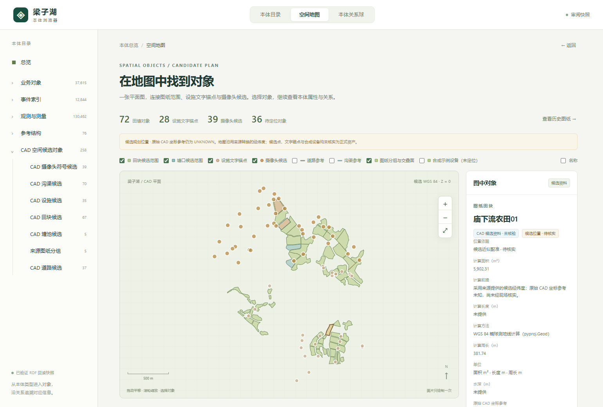
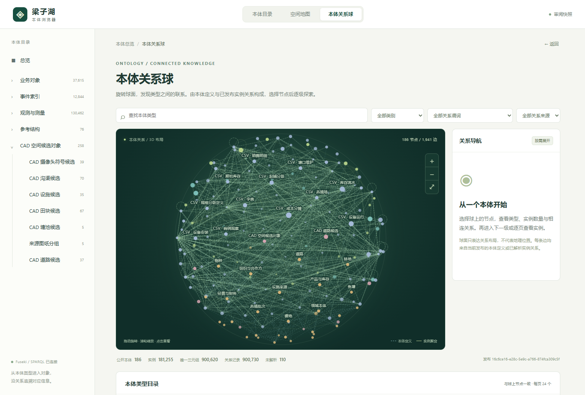
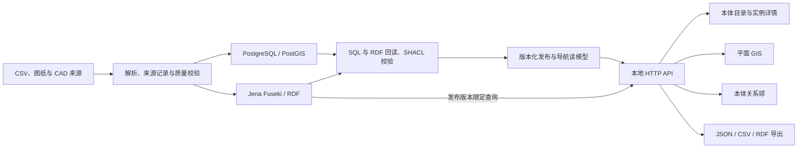

# 梁子湖农业本体数据库

将田块、塘口、设备候选、养殖记录和图纸证据放进同一套可追溯的本体关系中，通过平面 GIS、逐级本体目录和可旋转的关系球查看数据。

**当前可用入口：本地本体服务器。** 项目使用 PostgreSQL/PostGIS、Jena Fuseki/RDF 和轻量浏览器界面，支持批次导入、关系查询、地图浏览、版本回看及 JSON/CSV/RDF 导出。最近一次地图功能验收为 **2026-11-16**；本首页于 **2026-11-24** 更新，新增 Python 回归补测与时延报告，数据规模仍引用已验收发布。

[快速上手](ontology-platform/docs/local-server/快速上手.md) · [使用指南](ontology-platform/docs/local-server/使用指南.md) · [部署与换机](ontology-platform/docs/local-server/部署与换机.md) · [当前进度](ontology-platform/docs/status/2026-11-18-project-progress.md) · [开发指南](ontology-platform/README.md)

## 目录

- [项目可以做什么](#项目可以做什么)
- [界面预览](#界面预览)
- [系统如何组织数据](#系统如何组织数据)
- [当前数据与来源](#当前数据与来源)
- [快速开始](#快速开始)
- [导入、查询与导出](#导入查询与导出)
- [仓库目录](#仓库目录)
- [文档与验收证据](#文档与验收证据)
- [当前边界与后续工作](#当前边界与后续工作)

## 项目可以做什么

| 能力 | 使用方式 |
| --- | --- |
| 本体逐级浏览 | 从领域分类进入下级类型，再查看实例、属性、正向和反向关系；沿关联对象继续追溯。 |
| 平面 GIS | 查看田块、塘口、道路、沟渠、设施文字锚点和摄像头候选；支持平移、缩放、图层筛选及对象选择。 |
| 地图与本体联动 | 点击区域或点位进入对应本体实例，也能从实例返回地图中的同一对象。 |
| 球状本体关系网 | 拖动旋转、滚轮缩放、筛选关系；选择节点查看相连类型，再按需查看具体实例。 |
| 数据接收与核验 | 保存来源文件摘要、原始记录、字段、单位和质量状态；SQL、几何、RDF 及 SHACL 校验后发布。 |
| 版本化输入输出 | 导入形成发布版本，读取及分页固定 `release_id`；支持历史回看和 JSON、CSV、RDF 导出。 |
| 本地运维与迁移 | 提供服务启停、任务状态、日志、备份校验、恢复和新机器配置指南。 |

当前本体浏览器采用轻量原生 JavaScript，不需要启动 React Studio。仓库同时保留完整业务后端和 React 工作台开发模块，其运行方式及验收范围见[工程开发指南](ontology-platform/README.md)。

## 界面预览

### 平面 GIS 与区域对象

来源几何在一个平面呈现；重叠区域生成不重复绘制的面片，同时保留原始边界及全部相关对象。右侧可查看测量、定位依据和本体入口。



### 可旋转的本体关系球

球面用于展示类型之间的联系。节点和边来自已发布本体定义及实例关系聚合，球面位置不代表地理位置；运行服务后可实际拖动、缩放和点击。



[查看完整地图截图](ontology-platform/docs/local-server/screenshots/gis-flat-map.png) · [手机地图](ontology-platform/docs/local-server/screenshots/gis-sphere-mobile-map.png) · [手机关系球](ontology-platform/docs/local-server/screenshots/gis-sphere-mobile-network.png)

## 系统如何组织数据



| 层次 | 保存与表达的内容 |
| --- | --- |
| 本体类型 | 使用 OWL/RDFS 表达类型层级；实例通过 `rdf:type` 归属类型。 |
| 对象与属性 | 田块、塘口、候选设施、生产记录、观察和证据各有身份；数值保留类型、单位和数据性质。 |
| 关系 | 使用 RDF 对象关系表达对象关联；界面提供正反方向导航，空间派生关系附算法证据。 |
| GIS 几何 | PostGIS 保存原始及候选几何、坐标声明、来源和显示派生面片。 |
| 来源与质量 | 文件摘要、来源表/行、原文、缺值、冲突和未核实状态可追溯；来源与公开业务视图分开。 |
| 发布版本 | 校验通过后切换 active 版本；地图、关系网、实例及分页使用同一个发布 ID。 |

四个 PostgreSQL 数据库分别承载治理/核心、GIS、时序和资料数据；Jena 提供 RDF 存储与查询。当前轻量服务器沿用这些数据库及发布结果。完整平台的权限治理、事件同步与专业存储实现见[数据库说明](ontology-platform/database/README.md)。

## 当前数据与来源

### 已验收发布规模

发布 ID：`16c6ce16-e28c-5e9c-a766-874fca309c5f`。以下是 2026-11-16 的公开发布与导航口径，不包含全部私有来源图，也不代表同等数量的现场实物。

| 指标 | 数量 |
| --- | ---: |
| 公开发布 RDF 图 / 三元组 | 6 个 / 24,124,600 条 |
| 本体类型 / 实例 | 186 个 / 181,255 个 |
| 规范关系记录 / 已解析 | 890,235 条 / 890,125 条 |
| 历史未解析关系 | 110 条 |
| 关系球节点 / 类间边 | 186 个 / 1,941 条 |
| 当前地图目录 / 待定位对象 | 282 个 / 36 个 |

球网的 1,941 条边包含 1,311 条本体定义边和 630 条实例关系聚合边；它们与 RDF 三元组、规范关系记录属于不同统计口径。

### 数据批次与性质

| 来源 | 已接收内容 | 数据性质与说明 |
| --- | --- | --- |
| 完整养殖 CSV | 66 个业务 CSV、153,862 条记录、1,397 个字段 | 主体为规则模拟，天气为再分析，资产为复用目录；性质随记录保留。 |
| 五份竣工图 | 图形、文字、表格、尺寸和 3,202 条测量/指标等记录 | 保留纸面坐标、单位、冲突和来源证据；仍有 OCR、完整性和现场配准缺口。 |
| 新 CAD/GIS 批次 | 11 个固定来源文件、86 张来源表、32,464 条来源记录 | 来源为 `litt1eloser/liangzihu-farm-platform` 的固定提交；来源表包含元数据与 RTree。 |
| CAD 本体对象 | 67 田块、5 塘口、35 设施、39 摄像头符号、37 道路、70 沟渠、5 图纸分组 | 共 258 个候选对象、232 条关系；其中 246 个有显示几何。 |

来源原始坐标、候选转换坐标和派生测量分开保存。面积、周长和长度的计算值附算法及单位；未知水深保持未知。摄像头符号与设施文字锚点不直接等同于已核实的安装位置或在线设备。

[CSV 批次与验收](ontology-platform/docs/csv-batch/README.md) · [CAD 公开派生包](ontology-platform/datasets/cad-gis/README.md) · [关系球数据](ontology-platform/datasets/ontology-network/README.md) · [历史图纸资料](ontology-platform/docs/gis/drawings.md)

## 快速开始

### 已配置过本地服务器

在项目仓库根目录打开 PowerShell：

```powershell
cd ontology-platform
.\infra\local-server\local-server.cmd start
.\infra\local-server\local-server.cmd status
```

打开 [服务器首页](http://127.0.0.1:8792/) 或 [本体浏览器](http://127.0.0.1:8792/ontology/)，顶部可切换本体目录、空间地图和关系球。双击 `ontology-platform/infra/local-server/local-server.cmd` 也会启动并打开页面。

使用结束后正常停止：

```powershell
.\infra\local-server\local-server.cmd stop
```

当前没有安装开机自启；电脑重启后重新执行启动命令。`127.0.0.1` 代表当前电脑，这些链接不是公网演示站。

### 新电脑或首次克隆

```powershell
git clone https://github.com/lianggeming14/liangzihu-ontology-traceability.git
cd liangzihu-ontology-traceability\ontology-platform
powershell -NoProfile -ExecutionPolicy Bypass -File infra/local-server/setup.ps1
```

这一步准备 Python 运行依赖。完整服务还需要匹配版本的 PostgreSQL/PostGIS、Java/Fuseki、私有配置，以及空库初始化或完整备份恢复。GitHub 不保存活动数据库与凭据；新克隆不会自动获得上述 18 万实例。按[部署与换机](ontology-platform/docs/local-server/部署与换机.md)完成后再启动服务。

### 只查看仓库中的历史公开快照

无需数据库，使用 Python 标准库即可启动历史 CSV 审查页面。在仓库根目录执行：

```sh
cd ontology-platform
python scripts/serve_ontology_review.py --offline --port 0
```

打开终端输出的地址。该命令读取仓库中的历史五图快照；当前 CAD 地图与关系球使用前面的本地服务器入口。详见[历史本体审查说明](ontology-platform/docs/fish/ontology-review/README.md)。

## 导入、查询与导出

**导入 CSV：** 在服务器首页提交 UTF-8 CSV 或包含关联表的 ZIP，查看任务进度。写入使用本机私有配置中的令牌。每次普通 CSV 导入按完整独立批次发布；增量 GIS 更新应使用[专门的组合发布流程](ontology-platform/docs/local-server/使用指南.md)，以保留完整本体历史。

**查询：** 先选择浏览版本，再按分类、类型、实例和关系逐级查看。程序接入使用 `/api/v1/manifest` 获取类型 IRI，并在后续请求中固定 `release_id`。

| 只读接口 | 用途 |
| --- | --- |
| `GET /api/v1/status`、`GET /ready` | 服务状态和就绪检查 |
| `GET /api/v1/releases` | 当前发布及历史版本 |
| `GET /api/v1/manifest` | 类型目录、统计与发布信息 |
| `GET /api/v1/children?parent=<IRI>` | 本体直接下级 |
| `GET /api/v1/instances?class=<IRI>&limit=30` | 指定类型的实例分页 |
| `GET /api/v1/resource?iri=<IRI>` | 对象属性与关系 |
| `GET /api/v1/maps` | 当前平面地图和图层 |
| `GET /api/v1/network` | 本体类节点与聚合关系 |
| `GET /api/v1/network-relations` | 指定来源类型、谓词和目标类型的实例关系分页 |
| `GET /api/v1/export?class=<IRI>&format=json` | JSON、CSV 或 RDF 格式的分页导出 |

IRI 参数需要 URL 编码。JSON 的 `next_cursor`，或 CSV/RDF 响应的 `X-Next-Cursor` 非空时继续分页；导出单位是公开规范三元组，RDF 格式为 Turtle。页面中的“完整导出”也会按页读取。完整原件和全部 SQL/RDF 使用私有备份迁移。

## 仓库目录

```text
ontology-platform/              当前维护工程
  local_server/                 轻量服务器、任务、发布与读取接口
  docs/fish/ontology-review/     本体目录、地图、关系球及历史公开快照
  datasets/                     图纸、地图、CAD 和关系网公开派生数据
  scripts/                      解析、导入、校验、启动与维护脚本
  infra/local-server/           当前轻量部署入口、版本与依赖锁定
  backend/  frontend/            完整业务后端与 React 工作台开发模块
  database/  contracts/          数据库迁移、存储配置及接口契约
  tests/  docs/                 测试、指南、来源说明与验收记录
tools/                          GitHub 同步、快照和文档工具
implementation/                 历史 v0.4 工程
交付文档/  outputs/  设计草案/    历史交付与设计资料
```

当前运行和开发以 `ontology-platform/` 为入口。历史工程、早期 ZIP 和审查样本各有独立用途；历史记录中的数量、端口和命令应按对应日期阅读，不能代替当前服务配置。

## 文档与验收证据

| 要做的事 | 阅读入口 |
| --- | --- |
| 启动并使用本地服务器 | [快速上手](ontology-platform/docs/local-server/快速上手.md)、[完整使用指南](ontology-platform/docs/local-server/使用指南.md) |
| 了解项目进度和剩余任务 | [进度总结](ontology-platform/docs/status/2026-11-18-project-progress.md) |
| 复核新地图和关系球 | [交付报告与截图](ontology-platform/docs/local-server/gis-sphere-acceptance.md)、[实库核验](ontology-platform/docs/local-server/gis-sphere-native.json)、[Chrome 验收](ontology-platform/docs/local-server/gis-sphere-browser.json) |
| 复核完整 CSV 与本体关系 | [批次说明](ontology-platform/docs/csv-batch/README.md)、[字段字典](ontology-platform/docs/csv-batch/field-dictionary.json)、[RDF 回读](ontology-platform/docs/csv-batch/rdf-readback.json) |
| 使用 GIS 和公开 RDF 数据 | [CAD 数据包](ontology-platform/datasets/cad-gis/README.md)、[关系网](ontology-platform/datasets/ontology-network/README.md)、[图纸资料](ontology-platform/docs/gis/drawings.md) |
| 备份或迁移服务器 | [部署与换机](ontology-platform/docs/local-server/部署与换机.md)、[本机恢复验收](ontology-platform/docs/local-server/server-readback.json) |
| 修改工程或接口 | [开发指南](ontology-platform/README.md)、[数据库结构与存储](ontology-platform/database/README.md) |
| 同步项目成果 | [GitHub 同步约定](GITHUB_SYNC.txt) |

2026-11-24 Python 回归补测：**1546 通过、0 失败、4 跳过**，包含此前缺条件的 178 项 PostgreSQL 用例和真实视频解码；剩余符号链接权限条件及旧完整平台集成范围单列。真实 SQL/RDF 上的导入、查询、发布和完整分页导出时延见[本轮报告](ontology-platform/docs/local-server/python-regression-performance-20261124.md)与[性能复现指南](ontology-platform/docs/local-server/性能测试指南.md)。合成时延测试不替代生产全量或高并发验收。

前端模块 46 项及 Chrome 交互是 2026-11-16 的历史验收，此轮没有重跑现场浏览器。公网方案的检查边界见[密码与权限复核](ontology-platform/docs/local-server/connection-auth-audit-20261124.md)，域名、登录和 Tunnel 全流程见[固定 HTTPS 域名手册](ontology-platform/docs/local-server/https-domain-setup.md)。

## 当前边界与后续工作

- 五份图纸仍有 OCR 校核、背景对象矢量化、工程表冲突和完整覆盖缺口。
- 新 CAD 坐标是候选规划位置，原始坐标参考保留 `UNKNOWN`；现场定位、单塘水深和真实设备绑定仍需可靠证据。
- 保留 110 条历史未解析关系；合成、再分析、来源候选和现场数据需要继续区分。
- 已有同机备份恢复与换目录验收；最新 CAD 导入后的全库备份、第二台物理机、跨 OS 和 Docker 恢复仍需实际执行。
- 完整平台开发模块尚不等同于生产产品全部完成，历史 Graph/SPARQL 并发性能验收缺口仍保留在[数据库验收记录](ontology-platform/docs/database/acceptance.md)。

本仓库位于 **lianggeming14/liangzihu-ontology-traceability**，默认分支 `main`。代码、配置模板、公开数据和验收成果随交付同步；凭据、活动数据库、私有原件、备份和依赖按忽略规则保存在本机。GitHub 承载工程成果，数据服务由实际部署的服务器提供。
