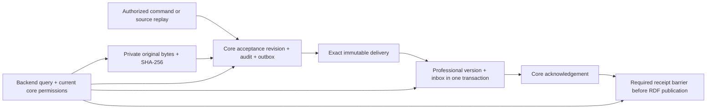

# Implemented schema and data flow

The authoritative inventory is [schema-inventory.json](schema-inventory.json), exported from the owned native **public** namespaces after migration. Core head is `0406_storage_backups`, GIS domain 4, time-series/catalog domains 3. It contains columns, nullability, defaults, constraints and indexes, not business rows or connection strings. The capture includes retained test tables `bootstrap_probe` and `delivery_test_effects`, PostGIS `spatial_ref_sys`, and twelve pre-created 2026 monthly partitions. Their presence is distinguished from application migrations; table totals are not entity/workload counts.

| Domain | Authoritative state / main tables | Relationships |
| --- | --- | --- |
| Core governance | `platform_users`, `platform_roles`, `permission_grants`, `resource_scopes`, `authorization_state` | Current identity/scope/action authority. Specialized index fields never grant access. |
| Core immutable ledger | `resource_heads`, `revisions`, `audit_events`, `outbox_events`, `revision_metadata`, `revision_visibility_dependencies` | UUID resource → monotonically numbered revision → exact event. Content digest and previous digest retain evidence; visibility dependencies are checked against current rights. |
| Core semantic workflow | `ontology_drafts`, `ontology_releases`, `ontology_installations`, `execution_bundles`, `semantic_objects`, `semantic_assertions`, `semantic_supports`, `semantic_type_declarations`, `projection_events`, `projection_heads`, inference tables | Definitions and execution bundles pin immutable versions. Support withdrawal retracts only that support; object identity/history remain. RDF/OWL is implemented in Fuseki, not replaced by these SQL indexes. |
| Core source/operations | `sources`, `source_records`, `source_positions`, `source_watermarks`, `ingestion_*`, `jobs`, `job_dependencies`, `job_attempts`, `idempotency_results` | Source composite identity, mapping/rule/bundle versions, conflict/ruling/recompute and job audit. External source databases remain read-only. |
| Core artifact/catalog/telemetry control | `artifact_versions`, `artifact_upload_sessions`, `artifact_quotas`, `catalog_entries`, `catalog_device_models`, `telemetry_batches`, `telemetry_record_keys`, `store_deliveries` | Accepted version identity is distinct from SHA-256 bytes; catalog device identity differs from model identity; telemetry accepts bounded manifests. Core delivery stores the exact immutable envelope and receipt. |
| GIS (`lzo_gis`) | `gis_geometry_versions`, `gis_geometry_heads`, `gis_spatial_assets`, `gis_location_observations` | Entity UUID/event/revision link immutable geometry and asset versions. GiST geometry and observation indexes serve spatial reads. Files remain private S3 assets. |
| Time-series (`lzo_timeseries`) | `telemetry_samples` and monthly partitions, `telemetry_identities`, `telemetry_supersessions`, `telemetry_batch_receipts` | Global source-record/version dedup and sample insertion share one target transaction; correction/withdrawal retains old rows. UTC partition boundaries are explicit. |
| Catalog (`lzo_catalog`) | `catalog_versions`, `catalog_heads` | Immutable accepted model/document/device association versions and monotonic heads. Exact reference pins can retain older metadata while current permissions still govern their evidence. |
| Each professional database | `store_inbox`, `store_heads`, `store_schema_version` | Inbox is keyed by event ID and verifies envelope/payload hashes. Version/head writes and target receipt share the domain transaction; core acknowledgement is a later replayable step. |
| Fuseki/TDB2 | Managed named graphs for schema, shape, candidate, accepted, provenance, derived; generation manifests and exact-term companion records | Resource UUID/IRI, revision, input position, graph digests and immutable dependency pins. A required GIS/time-series/catalog receipt fences corresponding RDF visibility. |
| S3 | Content-addressed immutable bytes plus private platform version references | Read authorization is reloaded from core. HTTP Range currently verifies the full object first. Upload sessions retain parts/orphans; logical quotas do not certify physical capacity or garbage collection. |

There are no cross-server foreign keys or distributed atomic commit claims. Cross-store references are UUID, stable IRI, accepted RevisionRef/event, hash and backend query/delivery contracts. Shared PostgreSQL is a common failure domain. Legacy `semantic_geometry` remains replay/migration evidence and an explicit legacy-mode compatibility path; split mode never maintains it as a second mutable current GIS authority.

An attachment on a semantic object appends `object.evidence_attached` through the normal object snapshot/GIS/RDF pipeline. A pre-fix contiguous `evidence.attached` tail can only be repaired by the explicit governed command; unknown intervening revisions, missing bytes or lost authority fail closed. No immutable old revision is rewritten. Catalog operational retry appends a separate scoped audit resource, preserving the catalog metadata head and exact accepted reference version.

Professional provenance is stored in the existing versioned JSON payloads; this additive contract needs no SQL migration and leaves the captured schema heads unchanged. Telemetry supports nullable structured `measurement_method` (name/version), `calibration` (version/method), `time_quality` (state/uncertainty_ms), and `media_metadata` (encoding, width/height resolution, sequence, timed gaps, verification). Models retain exact model/firmware pins and add nullable hardware version/equipment category. Documents add author, organization, agricultural scenario, language and manual-summary preparer. Unknown values remain unknown. New absent nullable fields are omitted from serialization; prior accepted record, batch and catalog representations/hashes stay exact, without rewriting immutable history.

Telemetry queries accept one validated `quality` selector (`valid`, `suspect`, `invalid`, `unknown`) and optional source UUID. Selection occurs before pagination and page aggregation and is included in cursor identity. Changing it invalidates the cursor. `latest=true` continues to select valid known numeric values and rejects an explicit non-valid quality.

`POST /api/v1/telemetry/archives` accepts an object/source UUID, exclusive `before` cutoff, optional inclusive `start`, explicit kind, optional quality and optional exact record UUID subset. It requires object edit plus current source, object, pin and evidence read authority. It captures acknowledged immutable history only, retaining the exact selected payloads, content hashes, source scope, selector and accepted event IDs in a private registered JSON artifact with a scoped `telemetry.archive.created` ledger/audit event. All original rows, evidence, partitions and current/latest values are retained. This is controlled archival, not physical space reclamation or a new retention duration.

Synchronous archive capture is limited to at most `min(1000,list_max_page_size)` records and 2,000,000 manifest bytes (also subject to the ordinary artifact upload budget/quota). The accepted-reference scan is capped at 10,000 rows and 2,000,000 bytes of selected JSON; these are work/result bounds, not a latency guarantee. A pending/failed/unavailable/incomplete selection, missing requested record, or oversized complete capture is refused. A caller must narrow the interval or explicitly select an exact subset; no truncated capture is called complete. `GET /api/v1/telemetry/archives/{id}` and generic artifact/history reads recheck the current source and each exact retained dependency. Archive bytes and audit remain immutable; current permissions can hide them after revocation. Existing backup/restore includes these core revisions and ordinary artifact bytes.
