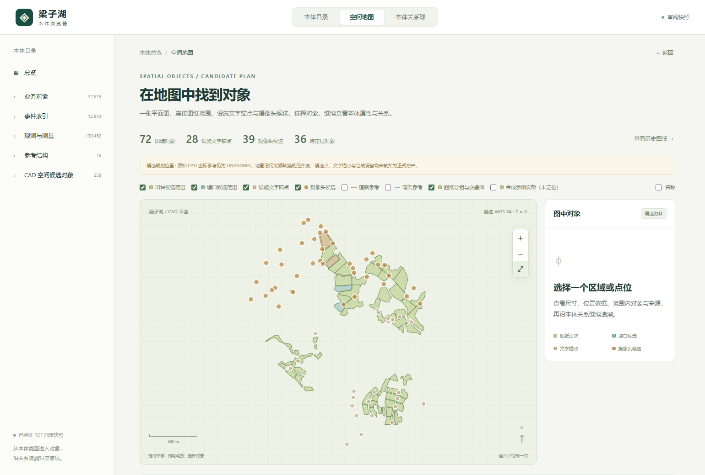
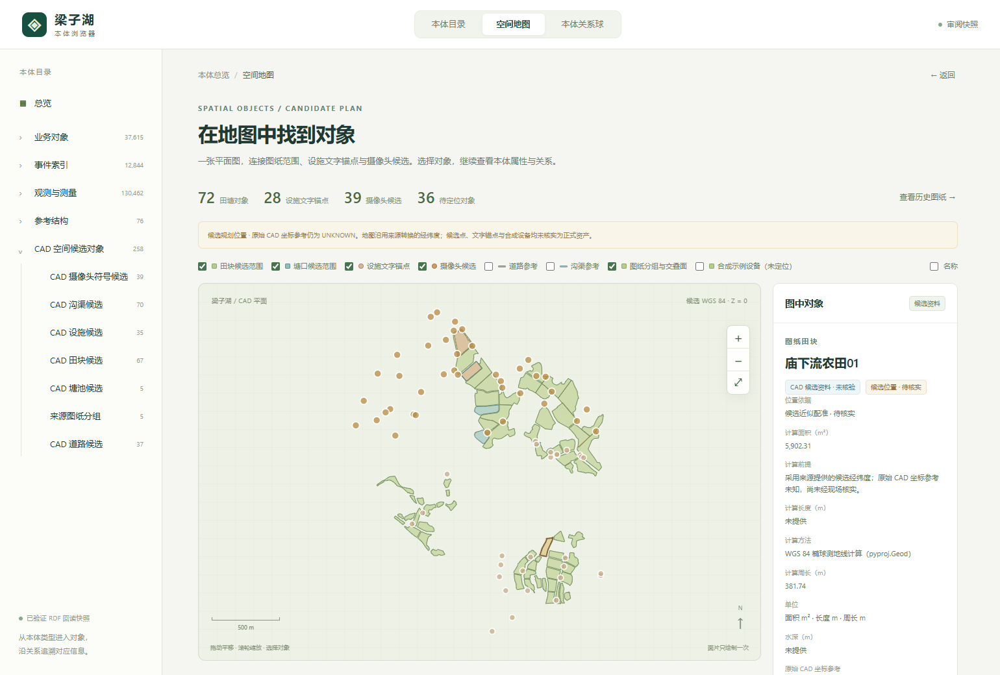
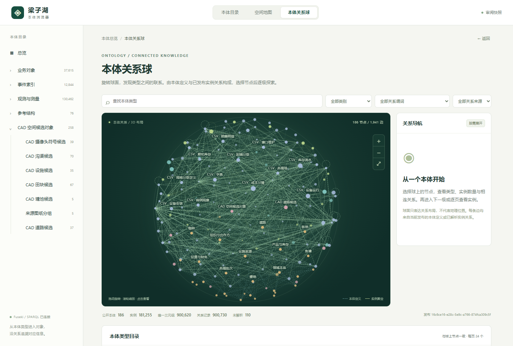

# 平面 GIS 与本体关系球：2026-11-16 交付

本机 PostgreSQL/PostGIS、Fuseki 和 HTTP 已发布版本 `16c6ce16-e28c-5e9c-a766-874fca309c5f`。打开 [本体浏览器](http://127.0.0.1:8792/ontology/)；顶部“空间地图”进入平面地图，“本体关系球”进入可拖动的关系网。启动、停止、导入和换机步骤见[使用指南](使用指南.md)。

## 本次接收与入库

只读采用 `litt1eloser/liangzihu-farm-platform` 的固定提交，未修改来源库。11 个选定文件逐字节校验通过，全部 86 张来源表、32,464 条来源记录已入库；来源原件、字段、原始几何、坐标声明、单位和来源行保留于私有批次。GPKG 的 128,267 个单元格另经逐项核对；86 表的口径包含元数据和 RTree，并不表示 86 张业务表。

| 新增本体候选对象 | 数量 | 位置依据 |
| --- | ---: | --- |
| 田块 | 67 | CAD 土地平整范围 |
| 塘口 | 5 | CAD 塘口范围 |
| 设施 | 35 | 28 个文字锚点，7 个无位置 |
| 摄像头符号 | 39 | CAD 符号候选点，未绑定真实设备 |
| 道路 | 37 | 来源线或面 |
| 沟渠 | 70 | 来源线或面 |
| 图纸分组 | 5 | 来源分组，无行政边界几何 |
| 合计 | **258** | 246 个可定位、12 个无几何 |

新增 232 条对象关系，包含 18 条点与区域的派生空间关系。空间落入只表示带算法证据的几何关系，不等同于设备所有权或正式业务归属。既有 24 条合成设备保持待定位，因此地图目录合计 282 个对象、36 个待定位对象。

67 个重复农田来源引用全部保留，主图只绘制一份。规范多边形共 75 个：72 个田塘、1 个道路面、2 个沟渠面；显示层切分为 81 个互不叠盖的面片，其中 7 个冲突面片保留所有关联对象。最大面片正面积交叠为 0；原始边界没有被覆盖。道路、沟渠默认可通过图层开关显示。

面积、周长、长度分别保存源值与 WGS84 椭球派生计算值，保留单位、算法和坐标假设。未知深度仍为空，未使用高程替代塘深。15,084 条未经确认的空间来源记录进入质量隔离目录，原始记录和字节全部保留，没有为了显示而补造坐标。

## 本体与接口

本次增加 69,740 条 RDF 陈述；当前 6 个公开发布图合计 24,124,600 条三元组、186 个类型、181,255 个实例。完整 Fuseki 所有图还包含私有/来源图，不能与公开发布统计混用。

关系球显示 186 个类型节点、1,941 条类间边：1,311 条本体定义边和 630 条实例关系聚合边。聚合输入的唯一实例三元组为 900,620 条，另有 110 条历史未解析关系；不存在为凑密集效果随机造边。点击类型进入详情与下级，点击关系逐页查看实例，每页最多 12 对。

新接口 `/api/v1/maps`、`/api/v1/network`、`/api/v1/network-relations` 与现有 `/api/v1/resource` 使用相同 IRI 和固定 `release_id`。地图、实例、地图反向跳转及关系下钻均已在真实浏览器验证。公开接口不返回完整 SourceRecord 或私有原文载荷。

## 验收结果

| 检查 | 结果与范围 |
| --- | --- |
| 新 SQL 与 PostGIS | 全行、字段及 EWKB 回读一致；7 张新增表，8,453 条几何记录包含原始隔离几何与显示候选几何。 |
| 新 RDF | 69,740 条完整词项集合回读一致，零缺失或多余。 |
| SHACL | 258 个候选实例通过。 |
| 历史保护 | 旧 678 个导航文件 SHA256 不变；旧 498 张表行数除发布登记从 1 增至 2 外不变，978 个旧 RDF 图计数不变；旧版本仍可访问。表行数/图计数检查不冒充旧库逐单元格重新回读。 |
| 幂等导入 | 同一批次重跑仍返回同一发布 ID 和 `idempotent=true`。 |
| Python 回归 | 233 通过、15 跳过；不含另行原生执行的 Store 测试。 |
| 原生 PostgreSQL Store | 隔离测试库 24 通过，不以 SQLite 替代。 |
| JS 地图/球体/导航 | 46 通过。 |
| Chrome | 地图主入口、对象与地图往返、测量显示、球体实际拖动/缩放、关系分页、历史版本、390 px 手机布局全部通过，零 JavaScript 错误。 |
| 换机资产路径 | `cad-imports` 已加入当前私有备份选项与未来恢复示例；固定在新 `data_dir/cad-imports`，错误根/目录及同大小文件损坏均有回归覆盖。 |
| 未执行 | 第二台物理机、跨 OS、Docker 和现场测量精度验收。本次未生成导入后的全库备份，换机前须按指南实际备份并校验。 |

机器可读证据：[实库与历史保护](gis-sphere-native.json)、[实际 Chrome](gis-sphere-browser.json)、[固定源清单](gis-source-audit-2026-11-16.json)。离线测试中的跳过不算实库通过；表中原生验收单列。

来源经纬度仍是候选规划位置，原始 CAD 坐标参考保留 `UNKNOWN`。39 个摄像头符号不代表 39 台已核实或在线设备；设施锚点也不代表实物安装点。原有 CSV 的合成性质继续保留。

## 可查看和复用的成果

- [CAD 公开派生包](../../datasets/cad-gis/README.md)：地图、258 个对象及测量、232 条关系、来源清单、3,449 条公开业务 RDF。此 RDF 是公开投影，不等于包含来源记录的 69,740 条入库陈述。
- [关系球聚合](../../datasets/ontology-network/README.md)：完整公开类节点与类间边，附 SHA256。
- [源准备与导入步骤](使用指南.md#更新已审查的-cad-空间数据)：下载固定版本、准备不可变批次、组合发布。完整私有原件与全部 SQL/RDF 随服务器备份恢复，不能只克隆 GitHub 就恢复活动数据库。
- 仓库旧 `--offline` 审查入口仍是历史 CSV 快照；当前新版地图和球网使用本地服务器 `/ontology/`，运行期全量导航由发布器生成，不将数千个分页文件当作源码复制。

手机完整截图：[地图](screenshots/gis-sphere-mobile-map.png)、[关系球](screenshots/gis-sphere-mobile-network.png)。
